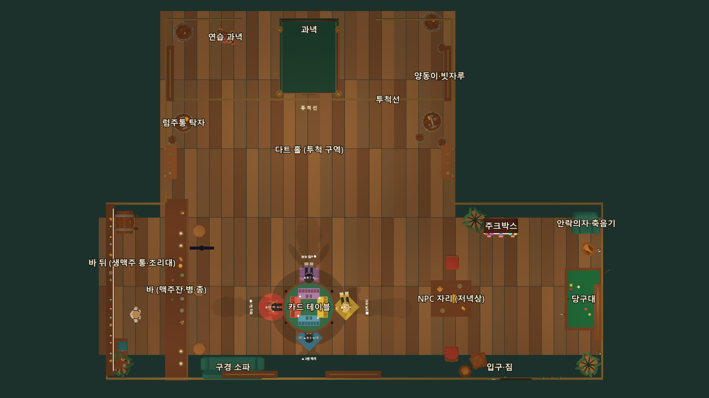

# 맵 도면 v3 — RG Poly 에셋 가구 (2026-10-31 밤)

다른 작업자가 보낸 에셋 묶음(itch.io Creator Bundle Vol.1, `Downloads\에셋.zip`) 중 **RG Poly 팩(CC0)** 의 모델을 고도 엔진에서 직접 재고, 그 크기로 F5 경기 방(`art/pub/pub_game.tscn`)의 빈 곳을 채웠다.
게임 규칙 좌표(과녁·투척선·카드 테이블·자리 4개·바·NPC 자리·당구대)는 **그대로**다. 봇·시험(`run_first_idea.py`, `bot_driver`)이 이 좌표를 쓰기 때문이다.

그림은 `tests/render_map_tour.gd` 가 실제 방을 위에서 찍은 것이다(높이 2.6m 위는 잘라 냄). 다시 찍기: `godot --path . --script res://tests/render_map_tour.gd` → `.godot/map_render/00_floor_plan_top.png`.

## 1. 구역

| 구역 | 있던 것 | 새로 넣은 것 (도면 v3) |
|---|---|---|
| 다트 홀 — 과녁 쪽 | 과녁 캐비닛·레인·로프·럼주통 | 럼주통을 나무통 모델로 교체 · **연습 과녁**(장식, 점수 없음) · 양동이·벽에 기댄 빗자루 |
| 다트 홀 — 투척 구역 | 럼주통 2개 | 통에 뚜껑을 덮어 **서서 마시는 탁자**(맥주잔·잔·치즈/빵) · 양옆 벽 **선반**(잔·단지) · 천장 아래 **전구 줄** |
| 바 | 카운터·꼭지·종·도형 컵·도형 스툴·병 선반 | **맥주잔 4개**(집어 마시는 소품) · 컵받침 · 빵·치즈 · 높은 바 스툴 · 병 선반을 코르크 병·병조림으로 |
| 바 뒤 | 바텐더·병 선반 | **받침대 위 생맥주 통** · 뒤 조리대 + 커피 머신·꿀단지 · 구석 화분 |
| 카드 테이블 | 테이블·자리 매트·도형 스툴 | 자리 색 방석 스툴(자리 색으로 구움) · 매트의 검은 카드 칸 → 자리 색 얕은 홈 |
| 라운지 뒷벽 | 창 2개 | **구경 소파**(창턱 아래) · 전구 줄 |
| NPC 자리 | 네모 테이블·도형 스툴·컵 | 나무 의자 2개(테이블을 본다) · 먹다 만 저녁(피자·버거·감자튀김) · 맥주잔 |
| 오른쪽 앞 구석 | 화분 | **안락의자 + 낮은 탁자 위 축음기** (화분은 오른쪽 뒤 구석으로) |
| 입구 옆 | 문·조명 스위치 | 나무 상자 둘(엇갈려 쌓음)·곡물 자루 · 옷걸이 고리 3개 |

플레이어가 지나는 길(자리 ↔ 투척선 가운데 복도, x −2~2)은 비워 두었다.

### 오락실 테마(테마 1)

`PubOnly` 묶음(소파·생맥주 통·뒤 조리대·바 뒤 화분)은 오락기·경품 진열대와 같은 자리라 오락실에서 뺀다(`LoungeWorld.ARCADE_SKIP`).
연습 과녁·선반·전구 줄·안락의자·축음기·상자는 두 테마 모두 남는다.

## 2. 충돌

새 가구의 충돌 상자는 `TableView.decor_blocks()` 가 만든다(자리 상수 `*_AT` + 측정 크기). 방 그림(`pub_game.tscn`)에는 충돌이 없다(원래 규칙 그대로).
자리 상수는 `layout_signature()` 에 들어가므로, 바꾸면 `pub_builder.gd` 를 다시 돌려야 한다(`test_game_look` 이 확인).

| 상수 | 자리 (x, z) | 충돌 크기 (가로 × 높이 × 깊이 m) |
|---|---|---|
| `KEG_AT` | (−7.5, 0.95) | 1.0 × 1.05 × 1.2 |
| `BACK_COUNTER_AT` | (−7.8, 6.3) | 0.9 × 1.0 × 1.26 |
| `PRACTICE_TARGET_AT` | (−3.4, −6.6) | 0.62 × 1.35 × 0.6 |
| `BUCKET_AT` | (5.3, −5.0) | 0.45 × 0.4 × 0.45 |
| `SOFA_AT` | (−3.1, 6.85) | 2.6 × 0.9 × 0.95 |
| `ARMCHAIR_AT` | (11.25, 1.0) | 1.16 × 0.9 × 0.95 |
| `SIDE_TABLE_AT` | (11.35, 2.05) | 0.56 × 0.4 × 0.56 |
| `CRATES_AT` | (6.95, 6.85) | 0.75 × 1.2 × 0.75 |
| `GRAIN_BAG_AT` | (6.35, 7.0) | 0.56 × 0.62 × 0.56 |

## 3. 상호작용 다시 정하기

| 물건 | 전 | 후 |
|---|---|---|
| 바 위 컵(도형) | 장식 | **맥주잔**(mug): 집기(좌클릭) → 한 모금(좌클릭, 병과 같은 마시는 몸짓·취기) → 던지기(우클릭 꾹). 나무라 **깨지지 않고 쏟아진다**(웅덩이 + 툭 소리 · 맞으면 "맥주 세례!") → 6초 뒤 채운 잔이 바 컵받침에 다시 놓인다 |
| 병 소품 | 카운터 앞 허공(x −4.76)에 떠 있었다 | 바 윗면 위(x −5.15)로 내림. 동작은 그대로(마시기·깨지기) |
| 바 종 | 장식 | **건드리기(F)**: "딩~" + 종이 흔들린다 (펍 테마) |
| 럼주통 4개 | 장식 | **건드리기(F)**: "통" 소리 + 통이 덜컹 흔들린다 (펍 테마) |
| 생맥주 통 | 없음 | **건드리기(F)**: 두드리는 소리 + 흔들림 (펍 테마) |
| 연습 과녁 | 없음 | **건드리기(F)**: 툭 + 흔들림 (두 테마) |
| 축음기 | 없음 | **건드리기(F)**: "톡" + 나팔이 흔들린다 (두 테마) |
| 방장 모니터 글자 | "[E] 방장 설정" (키가 F 로 바뀐 뒤에도 E) | 지금 상호작용 키 이름을 쓴다 |

건드리기는 점수·규칙에 영향이 없는 "만지는 재미"다(Pipes 류 게임처럼 손 닿는 물건이 반응하게). 방장이 받아 모든 화면에 같은 소리·흔들림을 보낸다(`lounge_fx` 이벤트의 `wobble` 값).
흔들리는 물건은 묶음 그리기(`static_batch.gd`)에서 빠져 있어야 보인다 — 에셋 메시는 원래 안 묶이고, 도형인 종은 `NO_BATCH_NAMES` 로 뺐다.

## 4. 에셋 — 고른 것과 측정값

측정: `art/vendor/rg_poly/rg_poly_baker.gd --sheet` (고도 창 모드). 후보 100개를 같은 각도로 찍고 크기를 쟀다. 측정표 그림·표는 `.godot/rg_poly_sheet/`(Git 제외)와 DARTY_프로젝트 작업내용 미리보기에 있다.

| 이름 (meshes/*.res) | 원본 | 원본 크기 (m) | 쓰는 곳 · 배율 |
|---|---|---|---|
| barrel / barrel_small | med:Barrel_1_A / Barrel_2_A | 0.86 × 0.91 × 0.89 | 럼주통(충돌 원기둥 크기에 맞춤) |
| barrel_lid | med:BarrelLid_A | 0.73 × 0.12 × 0.72 | 통 탁자 뚜껑 |
| keg | med:Barrel_3_A | 1.01 × 1.05 × 1.20 | 바 뒤 생맥주 통 ×0.95 |
| seat_stool_0~3 | rest:Stool_2_A | 0.44 × 0.57 × 0.44 | 자리 스툴 ×1.05 (방석 = 자리 색) |
| bar_stool | rest:Stool_4_A | 0.52 × 0.81 × 0.52 | 바 스툴 |
| chair | rest:Chair_1_A | 0.59 × 1.04 × 0.64 | NPC 의자 ×0.95 |
| sofa | rest:Sofa_2_A | 0.92 × 1.49 × 2.59 | 구경 소파 |
| armchair · side_table · gramophone | rest:Armchair_1_A · Table_1_A · Gramophone | 0.92 × 1.49 × 1.16 · 1.23 × 0.80 × 1.23 · 0.49 × 0.73 × 0.56 | 오른쪽 구석 (탁자 ×0.45/0.5, 축음기 ×0.75) |
| back_counter · coffee_machine | rest:StationTable_1_A · CoffeeMachine_1_A | 1.25 × 1.00 × 0.88 · 0.49 × 0.62 × 0.49 | 바 뒤 (머신 ×0.8) |
| practice_target | med:PracticeTarget_2_A | 0.59 × 1.32 × 0.84 | 다트 홀 장식 |
| bucket · broom | med:Bucket_1_A · Broom_A | 0.44 × 0.38 × 0.42 · 0.10 × 1.24 × 0.22 | 다트 홀 구석 |
| hang_shelf | rest:HangShelf_2_A | 0.51 × 0.80 × 1.38 | 다트 홀 옆벽 선반 |
| mug · goblet | med:Mug_1_A · Cup_2_1 | 0.25 × 0.24 × 0.30 · 0.14 × 0.25 × 0.14 | 맥주잔 ×0.6 · 잔 ×0.7 |
| shelf_bottle_0~3 · jar · honey_jar | med:Potion_3_1/4_1 · rest:Jar_1_A · HoneyJar | 0.08 × 0.21 × 0.11 | 병 선반 ×1.5 (몸통 = 병 4색) |
| pizza · burger · fries · bread · cheese | rest/med 음식 | 0.15~0.42 | NPC 저녁상 · 바 안주 · 통 탁자 |
| crate · grain_bag · hook | med:Box_1_A · GrainBag_1_A · Hook_1_A | 0.59³ · 0.56 × 0.62 × 0.56 · 0.16 × 0.24 × 0.11 | 입구 옆 |
| string_lights | rest:Lights_1_A | 0.11 × 0.41 × 2.12 | 천장 아래 전구 줄 |

`prop_bottle_0~2`(집어 던지는 병 후보)도 구워 두었지만 아직 쓰지 않는다 — 지금 병은 반투명 유리·라벨(PUB/SODA)·유리 파편 연출과 맞물려 있어 그대로 두었다.

### 쓰지 않은 것

- EmaceArt 팩(Food & Packaging, Analog Memory): 라이선스상 원본 재배포 금지 → 공개 저장소에 넣지 않는다.
- 실존 브랜드·영화 포스터·게임기 모양 모델(에셋 계획서 1-4).
- Cartoon City 팩(농구공·간판): 이번 범위 밖(압축이 커서 따로 풀어야 함). 다음에 오락실 소품 교체 때.
- 커튼·덩굴(측정해 보니 얇은 판이라 조명 아래에서 납작해 보임), 과일 그릇(빈 그릇처럼 보임).

## 5. 굽기(다시 만들기)

원본 `.glb` 는 저장소에 넣지 않는다. 쓰는 모델만 면마다 한 색(정점 색)으로 구워 `art/vendor/rg_poly/meshes/*.res`(41개, 약 0.8MB)로 넣었다.
텍스처·임포트가 없어 편집기를 열어 둔 채로 만들 수 있고, 우리 도형 소품(MeshKit)과 같은 각진 단색 면이 된다.

1. 에셋 묶음을 저장소 밖에 푼다: `rest/Models/…`(KitchenRestaurant), `med/Models/…`(Medieval) — 긴 경로 주의(Windows 260자).
2. `art/vendor/rg_poly/rg_poly_catalog.gd` 의 `used()` 에 `"이름": ["팩:파일", 팔레트 당김, {띠: 색}]` 한 줄을 넣는다.
3. `godot --headless --path . --script res://art/vendor/rg_poly/rg_poly_baker.gd -- --bake --source=<푼 폴더>`
4. `art/pub/game_room_builder.gd` 에서 `PubParts.asset(...)` 으로 놓고 `pub_builder.gd` 를 다시 돌린다.

색 규칙: 원래 색을 색상 띠(빨강·주황·노랑·초록·파랑·보라·무채색 3단)로 나눠 펍 팔레트(녹색 #24483E · 원목 #68442F · 놋쇠 #C4A566 · 크림 #C3B496 계열)로 당긴다. 밝기 차이는 남긴다. 음식은 덜 당겨(0.3) 맛있어 보이게 둔다.

## 6. 방 넓히기 v4 + 네온 오락실 개편 (2026-10-31 늦은 밤)

사용자 요청: "펍 맵과 네온 오락실 맵의 크기를 더 늘리고 층고도 조금 높이자", "네온 맵은 네온 사인과 인형뽑기 가게 느낌, 바텐더 대신 주스·음료", "벽 글씨가 창문과 겹쳐 잘린다", "코드로 만든 맵이 갈라져 보인다".

| 항목 | v3 | v4 |
|---|---|---|
| 다트 홀 `DART_HALL` | x -6.0~6.0 (12.0 m) | x -6.6~6.6 (13.2 m) |
| 라운지 `LOUNGE` | x -8.4~12.1, z 0~7.5 | x -8.4~13.6, z 0~9.0 (22×9 m) |
| 층고 `CEILING_HEIGHT` | 4.25 m | 4.8 m |
| 럼주통·작은 통 | 벽에서 0.3~0.9 m | x 를 0.6 m 바깥으로(벽과의 거리 그대로) |
| 양동이 · 소파 · 안락의자 · 축음기 탁자 · 상자 · 곡물 자루 | — | 벽을 따라 옮김(양동이 x+0.6, 소파·상자·자루 z+1.5, 안락의자·탁자 x+1.5) |
| 바 끝 냉장고 `BAR_FRIDGE_AT` | 없음 | (-5.375, 8.12), 0.95×1.95×1.44 m — 바 끝(z 7.4)과 뒷벽 사이 틈을 막는다 |

그대로인 것: 과녁·투척선·출입 금지선·레인, 카드 테이블·자리 4개, 바 카운터(`BAR_BOX`)·맥주잔·병 자리, NPC 자리, 당구대(= 농구 오락기), 생맥주 통·뒤 조리대·연습 과녁, 주크박스·방 설정 모니터, 오락실 규칙 좌표(인형뽑기·가챠·농구).

### 오락실 배치(테마 1)

- 창문 없음(`Windows` 묶음을 뺀다). 간판은 판 크기를 글자 크기로 계산(`ArcadeRoom._neon_sign`).
  - 다트 홀 옆벽: ARCADE(왼쪽) · DARTY(오른쪽), 과녁 벽 판넬(x ±2.7) 바깥: GAME OVER?/INSERT DART · HI-SCORE 180
  - 라운지 뒷벽: ★ NEON ARCADE ★, 인형뽑기 코너 위: CLAW · 인형뽑기, 오른쪽 벽: PRIZE ZONE, 주스 가게 벽: FRESH JUICE / 생과일 주스 · 음료
- 주스 가게(바 자리): 보라 카운터 + 하얀 윗면(1.1 m) + 네온 타일, 디스펜서 3대(오렌지·딸기·키위), 컵·믹서, 과일(그릇·딸기·바나나·레몬·블루베리·와플), 빨간 다이너 의자 3, 안쪽 금속 선반(캔·우유)·싱크대 2·메뉴판·줄무늬 차양 3, 주스 가게 직원(바텐더 모델 옷 바꿈).
- 바 끝: 하얀 음료 냉장고(색 캔 4칸) "COLD DRINKS".
- 인형뽑기 코너: 진짜 기계 `Rules.CLAW_AT`(8.6, 6.75) 옆에 장식 기계 4대 — 뒷벽 x 10.0·11.2·12.4(z 8.3), 오른쪽 벽 z 7.0 — 와 뒷벽 인형 진열 선반 2단(곰·오리). 진짜 기계 위에 큰 오리 인형.
- 오락기: 뒷벽 6대(x -4.4·-3.5·-2.5·2.5·3.5·4.5), 다트 홀 옆벽 4대(x ±6.11, z -0.65·-1.55). 모두 이 테마에서만 충돌.
- 천장: 벽 위 네온 레일 + 천장 보 아래 네온 관(청록·분홍 번갈아).

### 갈라짐 정리(펍 생성기 `_shell`)

- 바닥 판자 아래 어두운 밑판 · 판자를 칸별로 깔고 경계에서 자름 · 줄마다 이음매 엇갈림(1.1 m).
- 벽판: 튀어나온 모서리(다트 홀 옆벽 ↔ 단차 벽)에서 늘리지 않음 + 모서리 기둥. 징두리·난간·몰딩은 제 두께만큼만 늘려 맞물림.
- 천장판 두 장이 z=0 에서 겹치던 것(깜빡임)을 맞붙임. 라운지 보는 길이에 맞춰 3개.

### 더 구운 모델(같은 zip, CC0)

`juice_awning`(city Awning_1_A) · `juice_awning_red`(Awning_3_A) · `diner_stool`(Chair_2_A) · `juice_cup`(Mug_1_A) · `candy_jar`(Jar_1_A) · `plush_duck`(Duck_1) · `plant_pot`(PlantPot_1_A) · `trash_bin`(Trashbin_1_A) · `banana` · `lemon` · `strawberry` · `blueberries` · `milk` · `prep_sink`(Sink_A) · `metal_shelf`(StandShelf_1_A) · `waffle` · `juice_bowl`(Bowl_1_A) · `soda_can_0~3`(SodaCan_1_A, 빨간 몸통 4색).
측정표: `--sheet --only=city:,rest:Banana,...`(쉼표로 여러 앞글자). Cartoon City 는 zip 안의 zip 이고 `../../Textures/x.png` 를 참조하므로 `v/city/Models/<분류>/*.glb` + `v/city/Textures/` 로 풀어야 굽힌다.

